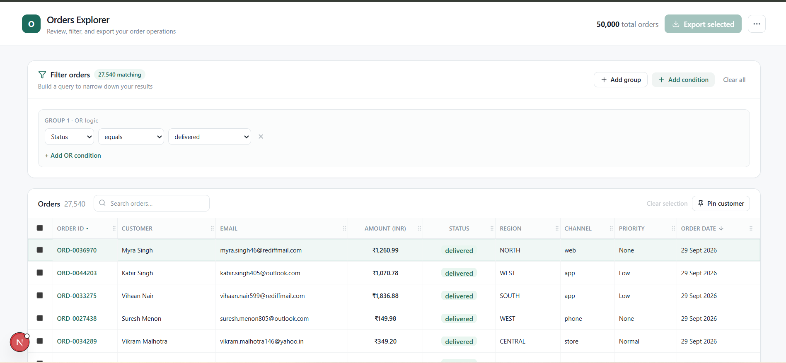
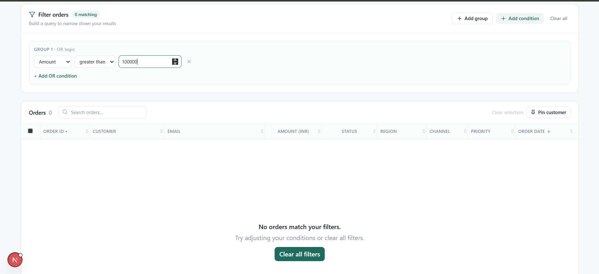

# Orders Explorer

A focused, frontend-only operations workspace for reviewing, filtering, sorting, selecting, and exporting order data. Built with Next.js, React, and TypeScript, it provides an interactive order management interface with a virtualized data grid and a flexible filter builder.

## Features

- **Order Data:** Static, deterministic sample orders generated in `data/orders.ts`.
- **Virtualized Data Grid:** Custom grid with overscan for efficient rendering, sticky headers, and row selection.
- **Column Pinning:** Keep the ID and customer columns visible while horizontally scrolling.
- **Sorting:** Sort orders by supported column values.
- **Filter Builder:** Create filter conditions and one-level groups with OR conditions and live matching counts.
- **Search:** Search orders to find relevant records.
- **Keyboard Navigation:** Navigate rows using the keyboard, press Enter to open order details, and press Escape to close the details panel.
- **Order Details:** Inspect information about a selected order.
- **CSV Export:** Export selected orders, including selected orders hidden by the current filters.
- **Responsive Layout:** Horizontally scroll the grid on narrower screens.
- **Empty State:** Display an empty-result state when no orders match the current criteria.

## Tech Stack

- **Framework:** Next.js 16
- **UI Library:** React 19
- **Language:** TypeScript
- **Styling:** Tailwind CSS 4
- **Icons:** Lucide React
- **Data:** Static, locally generated sample data
- **Grid:** Custom virtualized data grid

No backend or third-party table or virtualization library is required.

## Prerequisites

Before running the project, install:

- Node.js
- npm, included with Node.js

Verify your installation:

```bash
node --version
npm --version
```

## Getting Started

### 1. Clone the repository

```bash
git clone https://github.com/umar964/orders-explorer.git
cd orders-explorer
```

### 2. Install dependencies

```bash
npm install
```

### 3. Start the development server

```bash
npm run dev
```

### 4. Open the application

Visit:

http://localhost:3000

The development server supports hot reloading while you work on the application.

## Production Build

### Create a production build

```bash
npm run build
```

### Start the production server

```bash
npm run start
```

The application typically runs on port `3000`, unless that port is already in use or another port is configured.

## Project Structure

```text
orders-explorer/
├── app/                         # Application pages and layout
├── components/                  # Reusable UI components
├── data/                        # Order data and data definitions
├── design/                      # Design assets, if present
├── docs/
│   └── orders-explorer-design-boards.pdf
├── hooks/                       # Custom React hooks
├── lib/                         # Shared utilities and application logic
├── README.md                    # Project documentation
└── package.json                 # Dependencies and scripts
```

The structure above describes the main project directories. Individual files and directories may vary with the current implementation.

## Design References

The UI design references for Orders Explorer are available in the `docs/` directory.

**Design document:** `docs/orders-explorer-design-boards.pdf`

The document contains visual references for:

- Main orders dashboard
- Filter builder
- Order details panel
- Empty state
- Interaction behavior

These references illustrate the intended layout and interactions of the application.

## Data and Behavior

The application uses static, deterministic sample data, making the prototype easy to run locally and straightforward to adapt to a future API integration.

- Orders are generated in `data/orders.ts`.
- Selection is ID-based and remains preserved while filtering.
- CSV export handles values containing special characters.
- Export includes all selected orders, not just orders currently visible after filtering.
- Filtering and sorting operate on locally available order data.

## Known Limitations

- The application is frontend-only and does not currently use a backend API.
- Filter, sort, pin, and selection state are maintained in React memory for the current session.
- URL-based state persistence is reserved for a future data-router integration.
- Column resize handles are visual affordances in this version; functional column resizing is not implemented.
- The sample dataset is intended to demonstrate the interface rather than represent a live order management system.

## License

This project was created as a frontend application prototype. Add a license file if you intend to distribute it under a specific open-source license.

## Screenshots

### 1. Main Screen


### 2. Empty State
